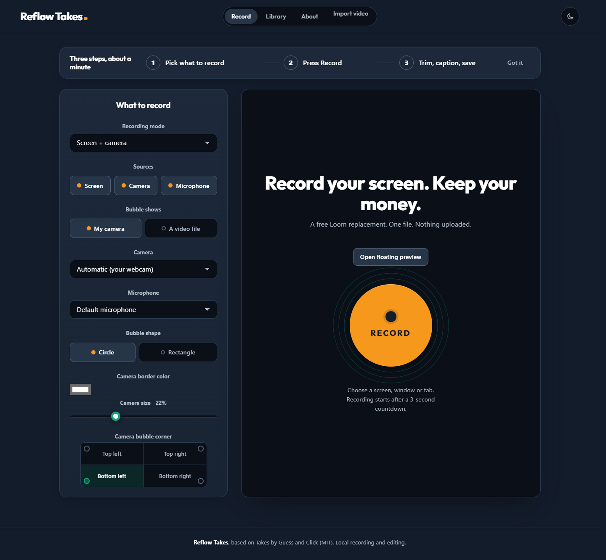

# Reflow Takes

An open-source, local-first screen recorder and video editor. Record your screen, camera and microphone, edit your takes, and export without an account or subscription.



## Features

- Screen, camera-only, or screen with an adjustable camera bubble.
- White camera border by default, custom border colors and a size control.
- Floating live preview in supported desktop Chrome/Edge, with drag-to-position camera controls.
- Import browser-decodable MP4, WebM and MOV videos.
- Trim, remove multiple sections, scrub the timeline, undo and redo.
- Caption generation in Dutch or English, processed locally with Whisper-base.
- Review and correct captions before approving them for burn-in or subtitle export.
- Free extractive titles from the kept transcript, preserving manually chosen names.
- Original-size or 1080x1920 portrait exports with a preview. Portrait fits the full picture without cropping.
- Local browser library, downloads, and optional writing to a folder you choose.
- Reflow navy, green and orange colors, with light and dark themes.

## Run locally

Requires a current desktop Chrome or Edge. Building and tests require Node.js 22 or later. No npm installation or API key is needed.

```sh
git clone https://github.com/reflow-automations/reflow-takes.git
cd reflow-takes
node build.mjs
node --test --test-reporter=tap
```

On Windows, open PowerShell in the repository and run:

```powershell
./Start-Reflow-Takes.ps1
```

Or start the local server directly with the Python launcher:

```powershell
py -m http.server 8767 --bind 127.0.0.1 --directory dist
```

Then open http://127.0.0.1:8767/takes.html. On other platforms, serve the dist directory with a static localhost server. The built dist/takes.html is a single-file application; opening it directly may have different permissions and browser storage from localhost.

Use the same browser and address to return to the same library. Download important recordings as backups.

## Editing and captions

Click the timeline or drag its white playhead. Use Start cut here and End cut here, then Add cut. Paused scrubbing inspects the original source; playback and export skip the cuts. Undo history lasts for the current browser session; edits persist in the local library.

For captions, choose the spoken language and generate the transcript. Correct the text and select Approve captions before burning it into a video or saving SRT/VTT subtitles. Text changes or changes to the cuts require approval again. Speech recognition can make mistakes.

Automatically named new recordings receive a local title when a transcript is available. Imports and custom titles keep their names unless you choose Use suggested title. Titling is a short phrase extracted from the transcript, not a generative summary. It does not start transcription automatically after every recording.

## Privacy and limitations

- The app has no account system, upload endpoint, tracking or hosted recording library.
- Editing/export tools are bundled. Caption tools and the pinned speech model are fetched from external CDNs on demand (approximately 100-170 MB); inference runs in your browser. Network access is needed for model/software downloads, and full offline use after restarting is not guaranteed.
- A chosen cloud-synced folder can be uploaded by your own sync client. Reflow Takes only writes the local file.
- Browser storage is not an encrypted backup and can be cleared. Recording initially uses memory. Long recordings and all device/codec combinations have not been validated.
- An entire-screen capture may include the floating preview itself. Share a tab/window or place the preview on another monitor.
- Caption timings are sentence-level. Check text when cutting through a spoken sentence.
- Failed or incomplete edits block export instead of silently downloading the original.
- This is a personal recorder/editor, not a hosted sharing, analytics or collaboration service.

## Project structure

- src/: application shell, styling and classic JavaScript modules.
- build.mjs: deterministic single-HTML build, including the vendored export bundle.
- tests/: Node tests using stand-ins for browser media APIs.
- vendor/: Mediabunny bundle, integrity manifest, license and original source package.
- dist/takes.html: ready-to-serve build.

## License and origin

Reflow Takes is based on [Takes by Guess and Click](https://github.com/chelsieslocum-jpg/takes-guessandclick-net), source revision 2f57260d5ebbca5a855fcf6ba58cd6740213948b. The original MIT notice is retained in [LICENSE](LICENSE); Reflow modifications are also MIT-licensed.

This public repository starts from a curated source snapshot. Internal development notes, local paths, recordings and private development history are not included. See [THIRD_PARTY_NOTICES.md](THIRD_PARTY_NOTICES.md) for separately licensed dependencies.
